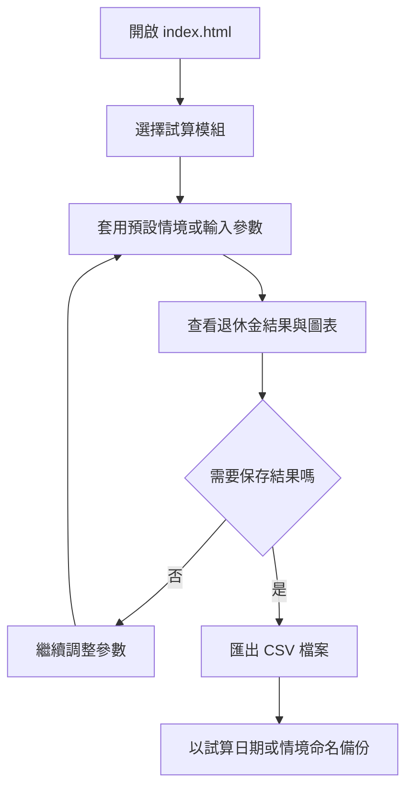

# 鎖頭銀行退休金試算中心｜使用者操作手冊

鎖頭銀行退休金試算中心是一組可直接在瀏覽器開啟的繁體中文退休金試算工具，提供綜合退休金、勞退新制、公保退休金與多情境比較等功能。使用者可以輸入個人條件、套用預設情境、查看計算結果，並將試算結果匯出為 CSV 檔案。

## 目錄

- [快速開始](#快速開始)
- [整體使用流程](#整體使用流程)
- [頁面與導覽](#頁面與導覽)
- [主要功能操作](#主要功能操作)
- [資料匯出與保存](#資料匯出與保存)
- [隱私與資料安全](#隱私與資料安全)
- [常見問題](#常見問題)
- [維護者驗證](#維護者驗證)

## 快速開始

1. 在檔案總管開啟本資料夾。
2. 雙擊 [`index.html`](index.html)。
3. 在首頁選擇要使用的試算模組，或從頁面上方導覽列直接前往其他試算頁。
4. 輸入或調整參數，查看即時更新的試算結果。

本工具是靜態 HTML 應用程式，不需要安裝 Node.js、Python、資料庫或其他套件。一般使用情境也不需要啟動伺服器。

## 整體使用流程



## 頁面與導覽

所有頁面上方都有相同的網站導覽列；在任一試算頁選擇「首頁」即可回到 `index.html`，也可以直接切換到其他試算頁。

| 頁面 | 用途 |
|---|---|
| [`index.html`](index.html) | 綜合入口、三大模組摘要、跨模組比較與完整 CSV 匯出 |
| [`鎖頭銀行退休金試算器_正式版.html`](鎖頭銀行退休金試算器_正式版.html) | 綜合退休金的一次領試算，適合快速檢視基準、進階與高薪情境 |
| [`鎖頭銀行退休金試算器_多情境版.html`](鎖頭銀行退休金試算器_多情境版.html) | 勞退新制的多情境比較，包含提繳率、報酬率、稅率與請領方式調整 |
| [`鎖頭銀行退休金試算器_公保.html`](鎖頭銀行退休金試算器_公保.html) | 純公保養老給付試算，支援給付規則、年資與職等資料比較 |
| [`鎖頭銀行退休金試算器_勞退新制.html`](鎖頭銀行退休金試算器_勞退新制.html) | 勞退新制專戶試算，支援月領／一次領、複利圖表與逐年明細 |

## 主要功能操作

### 首頁：綜合退休金試算中心

1. 在「核心工具入口」查看綜合退休金、勞退新制與公保退休金三個模組摘要。
2. 點選模組按鈕，頁面會切換到對應的試算區域。
3. 使用工作區上方的分頁切換綜合退休金、勞退新制、公保退休金與三軌比較表。
4. 使用「快捷年資與職階範例」或其他預設按鈕快速帶入參數。
5. 在輸入欄位調整薪資、年資、給付月數、提繳率或其他條件。
6. 使用「下載完整比較試算表 (CSV)」保存首頁的跨模組比較結果。

### 綜合退休金正式版

此頁適合快速估算綜合退休金的一次領金額。

- 點選情境按鈕快速帶入基準、中階或高階薪資組合。
- 直接修改退休前月薪資與公保保俸，結果會即時更新。
- 按「重設為預設值」回到預設基準值。
- 按「複製摘要」將目前結果複製到剪貼簿；若瀏覽器拒絕剪貼簿權限，可改用手動選取結果。

### 多情境版

此頁適合比較不同勞退新制條件下的長期結果。

1. 先選擇「初入職場」、「中堅世代」、「管理專才」或「樂齡衝刺」情境。
2. 調整雇主提繳率、個人自提率、預估工作年資與年化報酬率。
3. 依需要設定所得稅邊際稅率與退休後請領方式。
4. 在圖表區切換「專戶本金與收益組成」或「有自提／無自提對比」。
5. 查看逐年累積明細，最後按「匯出試算表 CSV」下載結果。

### 公保退休金

此頁專門估算純公保養老給付。

- 使用快速情境範例帶入常見職等與年資。
- 在「直接輸入公保保俸」與「由每月薪資連動」之間切換輸入方式。
- 選擇經典分段制、1.2 倍年資制或自訂給付月數。
- 選擇當月公保保俸或近 10 年平均保俸作為計算基礎。
- 可在職等薪資表篩選職等並套用資料。
- 使用「儲存目前情境」暫存多組比較條件；需要時可載入或移除情境。
- 使用「匯出比較表」下載 CSV，或使用複製功能複製目前摘要。

### 勞退新制

此頁適合檢視勞退專戶的長期複利累積。

1. 選擇預設情境或自行輸入月提繳工資、雇主提繳率、個人自提率與工作年資。
2. 選擇預估年化報酬率。
3. 在「月退休金估算」與「一次請領總額」之間切換。
4. 視需要設定平均餘命與稅率等進階條件。
5. 使用圖表模式查看本金／收益組成或自提與不自提的差異。
6. 展開逐年明細後，按「匯出明細 CSV」保存報表。

## 資料匯出與保存


- 試算結果會在目前頁面中即時更新。
- 各頁提供 CSV 匯出功能，檔名會依頁面用途自動產生。
- CSV 是下載檔案，不會自動同步到其他頁面或雲端。
- 若要保存特定情境，請在下載後自行備份 CSV；重新整理或關閉頁面前，先完成匯出。
- 公保頁的「儲存情境」只用於目前頁面的情境比較，不等同於永久檔案備份。

## 隱私與資料安全

- 本工具沒有後端帳號、資料庫或登入流程。
- 請避免在共用電腦輸入不希望他人看到的個人薪資資料。
- 下載的 CSV 可能包含薪資、年資與試算結果，請依公司或個人資料管理規範保存。
- 試算結果僅供規劃參考，實際退休金仍應以相關法規及承保／主管機關核定結果為準。

## 常見問題

### 雙擊後畫面沒有正常顯示

請使用現代瀏覽器（例如 Chrome、Edge 或 Firefox）重新開啟 `index.html`。若瀏覽器對本機檔案的下載或剪貼簿功能有限制，可用 VS Code Live Server 或其他靜態檔案伺服器開啟同一資料夾。

### CSV 沒有下載

先確認瀏覽器沒有封鎖下載，並檢查下載資料夾。若仍無法下載，重新整理頁面後再按一次匯出按鈕。

### 複製摘要沒有反應

這通常是瀏覽器未授予剪貼簿權限。請允許目前頁面的剪貼簿權限，或直接使用 CSV 匯出功能。

### 想回到預設值

按該頁的「重設預設值」或「重設預設參數」。部分頁面採用再次點擊確認機制，看到按鈕文字變更後請再點一次。

### 不確定應該使用哪一頁

先開啟首頁：需要整合比較時使用首頁；只看公保給付時使用公保頁；只看勞退新制複利時使用勞退新制頁；需要比較不同提繳與報酬情境時使用多情境版。

## 維護者驗證

本專案目前沒有 `package.json`、測試腳本或建置流程；修改後可用下列檢查確認導覽與檔案結構沒有被破壞：

```powershell
# 在專案根目錄執行
$files = Get-ChildItem -Filter *.html
foreach ($file in $files) {
  $html = Get-Content -Raw $file.FullName
  if ($html -notmatch '<nav class="site-nav"') { throw "$($file.Name): missing site navigation" }
  if (([regex]::Matches($html, '<nav\b')).Count -ne ([regex]::Matches($html, '</nav>')).Count) {
    throw "$($file.Name): nav tag mismatch"
  }
}
Write-Output 'HTML navigation checks passed.'
```

修改 README 後，建議再執行：

```powershell
git diff --check -- README.md
```

此資料夾若未初始化 Git，`git` 指令會無法執行；這不影響 HTML 工具本身的使用。
